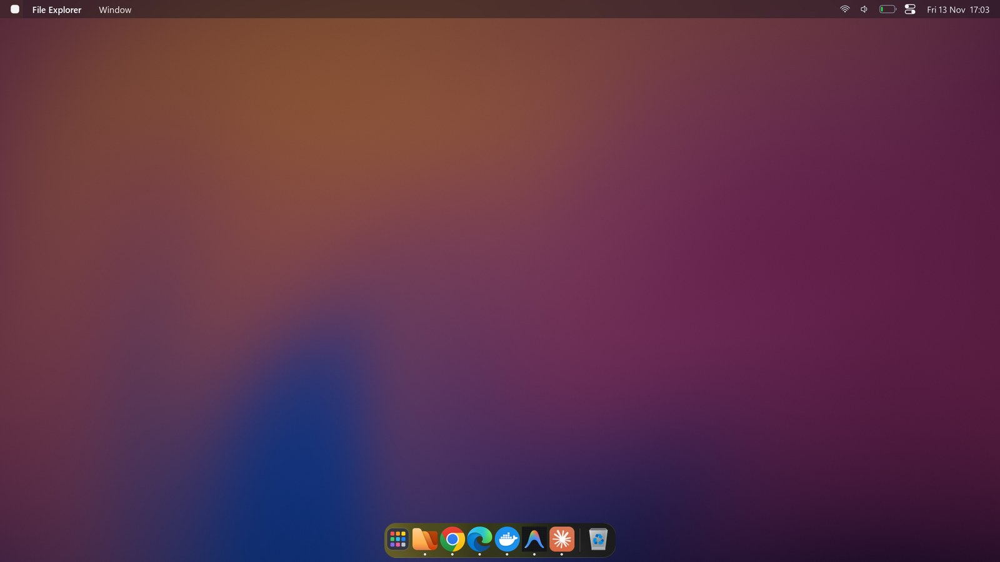
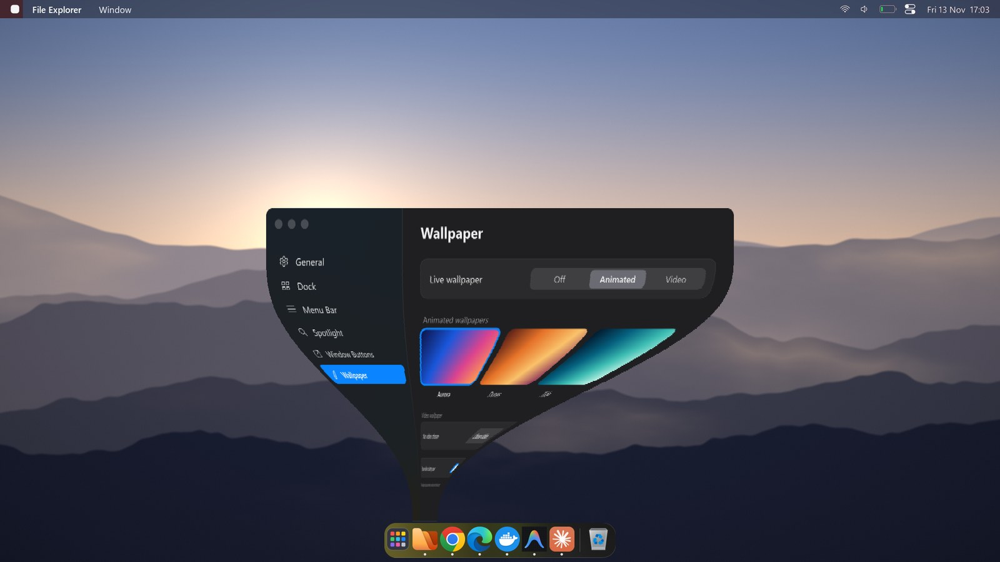
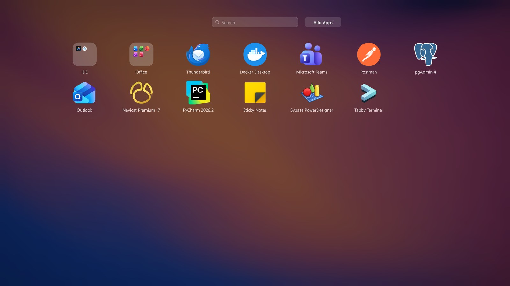
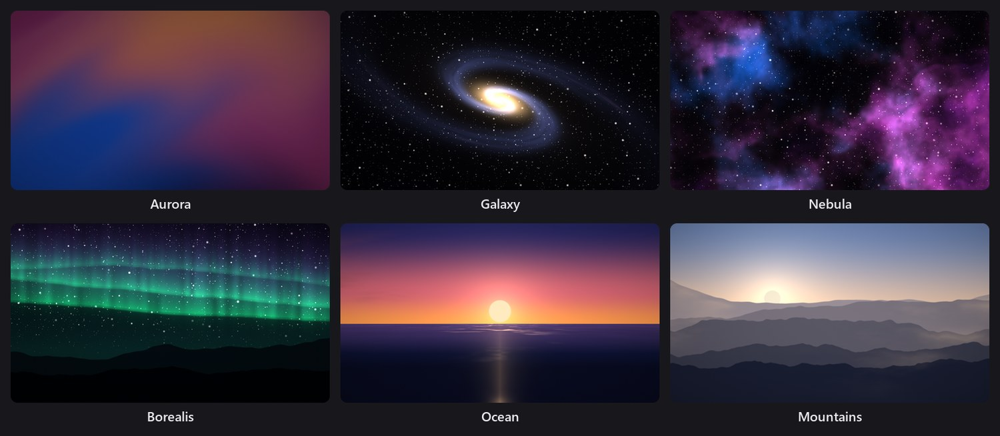

# WinMacDock

A light macOS-style desktop for Windows 11, written in Rust + Win32 (no WebView, no .NET). One `.exe` of about 700 KB, one process.



| Genie minimize into the Dock | Launchpad with folders |
|---|---|
|  |  |

**Live wallpapers** (GPU shaders, a few MB of RAM):



## Install

Run `dist\WinMacDock-Setup-<version>.exe`. It installs for the current user only (no administrator rights) into `%LOCALAPPDATA%\Programs\WinMacDock`, adds Start-menu entries, and can start WinMacDock at sign-in.

Uninstall from **Settings → Apps → Installed apps → WinMacDock**. Uninstalling quits WinMacDock and brings the Windows taskbar back.

## Features

- **Dock**: pinned and running apps, magnification, launch bounce, running dots, name labels and auto-hide.
  - Clicking an app that is not in front brings all of its windows forward.
  - Clicking the app in front minimizes all of its windows (the front one with the genie effect).
  - Right-click shows the app's windows, plus Keep in Dock / Remove from Dock and Quit.
- **Menu bar**: the system menu, the active app's name and a **Window** menu (Minimize, Zoom, Bring All to Front and the list of windows). On the right:
  - other apps' **tray icons**. Click and right-click are passed through to each app.
  - Wi-Fi, Sound, Battery, **Control Center** and the clock. Each opens WinMacDock's own panel, not the Windows flyout:
    - Wi-Fi: on/off, network list and joining a network. A password is entered right in the panel.
    - Sound: volume, mute and choice of output device.
    - Battery: charge and power source.
    - Control Center: Wi-Fi, Bluetooth and Dark Mode toggles, display brightness, volume, Now Playing controls, Lock Screen and Screenshot.
    - Clock: a calendar.
- **Launchpad**: starts empty. Click **Add Apps**, then click apps to add or remove them (blue check = in Launchpad), then **Done**. Type to filter; right-click an app to add it to the Dock or remove it from Launchpad. Drag icons to rearrange them (rest at the screen side to change page). Drop an app onto another to make a folder; click a folder to open it, click its name to rename it, and drag an app out of the panel to take it out of the folder.
- **Spotlight**: a keyboard shortcut that you choose in Settings. Type to search, then Enter to open.
- **Window buttons**: Windows' own minimize / maximize / close buttons are replaced in place by red, yellow and green buttons, also in apps that draw their own title bar (browsers, Electron apps). Apps that do not report their buttons to Windows keep their own.
- **Genie minimize**: every minimized window flows into its Dock icon along an S-shaped curve, whether it is minimized from the Dock, the yellow button, Win+Down or the app itself (Windows' own minimize animation is turned off while WinMacDock runs).
- **Window previews**: hover a running app in the Dock to see live thumbnails of its windows; click one to switch, or its × to close it.
- **Power menu** (menu-bar logo): Sleep, Hibernate (when enabled on the PC), Restart…, Shut Down…, Lock Screen and Log Out…; the last three ask first.
- **Live wallpaper**: animated wallpapers in three groups (Abstract, Nature, Space), with a Calm / Normal / Lively speed setting, or a video of your choice. It pauses when the desktop is covered, the screen is locked or (optionally) the PC runs on battery.
- **Several displays**: every display gets the menu bar and wallpaper; the Dock follows the pointer to the display you use.

## Starting with Windows

With "Start WinMacDock when you sign in" on, a restart or sign-out leaves the Windows taskbar hidden, so the next sign-in shows WinMacDock instead of the taskbar. Windows still waits a few seconds after sign-in before starting startup apps; **Settings → General → Skip Windows' startup delay** removes that wait (it applies to all of your startup apps).

## Settings

Open **Settings** from the menu-bar logo (WinMacDock Settings…), from the Dock's right-click menu, or from the Start-menu entry **WinMacDock Settings**. Changes apply immediately.

Settings are stored in `%APPDATA%\WinMacDock\config.toml`. If you edit that file by hand, run `winmacdock.exe --reload` to apply it.

## Command line

| Command | What it does |
|---|---|
| `winmacdock.exe` | start |
| `--settings` | open Settings (starts WinMacDock if needed) |
| `--launchpad`, `--spotlight` | open Launchpad / Spotlight |
| `--reload` | re-read `config.toml` |
| `--quit` | quit (`Ctrl+Alt+Shift+Q` also works) |
| `--restore` | bring the Windows taskbar back after a forced kill |
| `--frame-stats` | log animation frame timing to `%APPDATA%\WinMacDock\log.txt` |

## Building

Needs Rust (MSVC toolchain) and Visual Studio Build Tools (C++ workload). The installer also needs Inno Setup 6 (`winget install JRSoftware.InnoSetup`).

```powershell
cargo build --release              # target\release\winmacdock.exe
.\scripts\build-installer.ps1      # dist\WinMacDock-Setup-<version>.exe
.\scripts\make-icon.ps1            # regenerate assets\app.ico
```

## Resource use

Measured on a laptop with Intel Iris Xe graphics, 1920×1080 at 125%:

| State | RAM (working set) | CPU |
|---|---|---|
| Idle, wallpaper paused | about 20 MB | under 1% of one core |
| Video wallpaper playing | about 60 MB | about 11% of one core |

The Dock and Launchpad animate at 60 fps on that machine.

## Limitations

- WinMacDock cannot show other apps' own menus (File / Edit / View) in the menu bar, because Windows does not expose them.
- Apps that do not report their title-bar buttons to Windows keep their own buttons.
- When a window minimizes by itself (Win+Down, its own button), the genie uses a picture taken in the background up to a few seconds earlier.
- With several displays, every display gets the menu bar and live wallpaper. The Dock sits on one display and moves to another when you push the pointer against that display's bottom edge (like macOS). Launchpad and Spotlight open on the main display. A secondary display with a different scale uses the main display's scale.
- Another program that also hosts tray icons can hold that role first, for example another dock app. In that case WinMacDock leaves it alone and shows no tray icons.
- WinMacDock uses no Apple artwork. App icons come from Windows.

## License

[MIT No Attribution](LICENSE). Use, change, rebrand (white-label) and sell it freely, with no need to credit this project.
